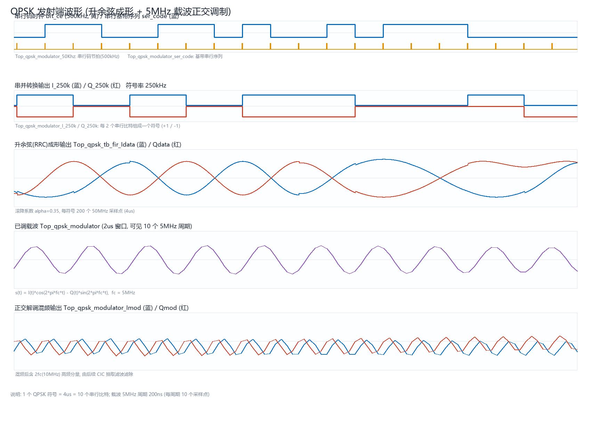
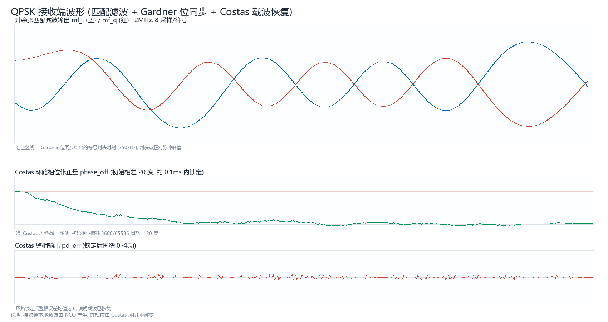
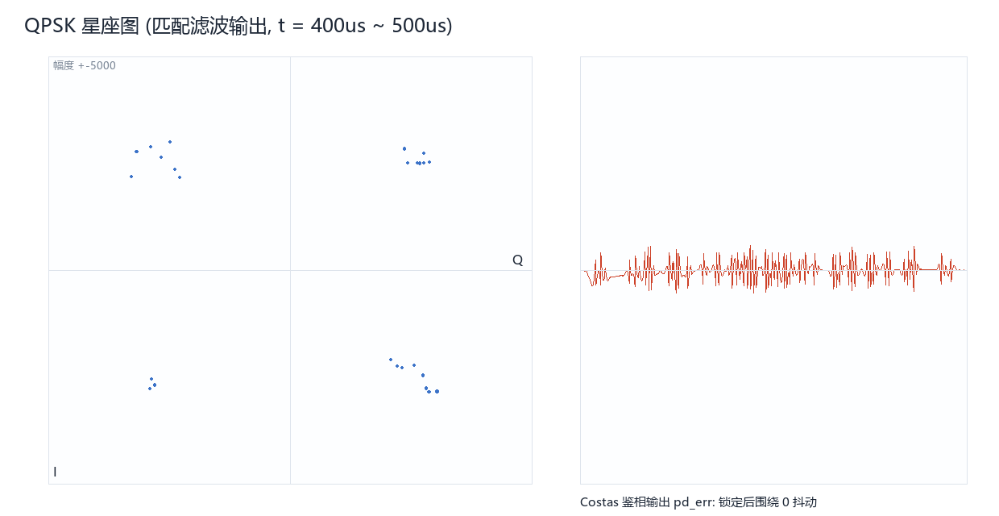

# QPSK 调制解调 FPGA 实现（ALINX AX7010 / Vivado 2025.2）

面向毕业设计的完整 QPSK 调制解调链路：伪随机数据源 → 汉明编码 → 串并转换 →
升余弦成形 → 5 MHz 载波正交调制 → （环回信道）→ 正交相干解调 → CIC 抽取 →
升余弦匹配滤波 → Costas 载波恢复 → Gardner 位同步 → 判决 → 汉明译码 → 误码统计。

**所有乘法器均用 Verilog 代码描述（`a * b`），不调用任何乘法器 IP**；并针对
FPGA 资源做了专门优化（详见第 6 节）。

---

## 1. 主要指标

| 项目 | 数值 |
|---|---|
| 主时钟 `clk` | 50 MHz |
| 载波频率 | 5 MHz（每载波周期 10 个采样点） |
| 基带（信道）码率 | 500 kbit/s |
| QPSK 符号率 | 250 kHz（I/Q 各一路，每符号 2 bit） |
| 成形/匹配滤波滚降系数 | α = 0.35 |
| 调制输出 `modulator` | 16 bit 有符号 |
| 解调输出 `rx_data` | 8 bit（汉明译码后的载荷字节） |
| 实测误码率 | 0（10 ms 仿真，4980 bit 比较，0 错误） |
| 目标器件 | XC7Z010-1CLG400C（Zynq-7000，AX7010） |

> **关于 `Top_qpsk_modulator_50Khz` 这个信号名**：沿用需求清单中的命名。
> 本设计中"基带信号 500 kHz + I/Q 250 kHz"是严格自洽的 QPSK 关系
> （500 kbit/s ÷ 2 bit/符号 = 250 kbaud），因此串行码节拍实际为 **500 kHz**。
> 若答辩要求串行时钟必须是 50 kHz，把 `rtl/qpsk_cfg.vh` 中 `BIT_DIV` 改为 1000，
> 并把 `clk_en_gen` 的 `SYM_DIV` 改为 2000 即可（此时符号率变为 25 kHz，
> 载波 5 MHz 不变，其余均自动适配）。

---

## 2. 目录结构与工程文件

### 2.1 Vivado 工程（直接用 GUI 打开）

工程文件已经生成好：

```
vivado_proj\qpsk_ax7010\qpsk_ax7010.xpr
```

打开后：

1. Sources 里顶层已经是 `Top_qpsk`（14 个 `.v`），`.vh` 已加入 include 目录；
2. 点 **Run Simulation → Run Behavioral Simulation** 即跑 `Top_qpsk_tb`，
   波形窗口展开 `Top_qpsk_tb` 就能看到 5.3 节列出的全部观测信号；
3. 点 **Run Synthesis / Run Implementation / Generate Bitstream** 走完整流程
   （器件 `xc7z010clg400-1`，约束 `constr/ax7010_top.xdc` 已加入）。

> 工程内部用相对路径（`$PPRDIR/../../rtl/...`），保持
> `vivado_proj/` 与 `rtl/`、`sim/`、`constr/` 的相对位置，整个目录可直接拷走。
>
> 工程被误删时，执行下面命令重新生成：
> ```
> vivado -mode batch -source scripts/create_project.tcl -notrace
> ```

### 2.2 目录结构

```
QPSK_AX7010/
├─ vivado_proj/qpsk_ax7010/qpsk_ax7010.xpr   ★ Vivado 工程文件
├─ rtl/                       可综合 RTL
│   ├─ qpsk_cfg.vh            全局参数
│   ├─ Top_qpsk_board.v       ★ 板级顶层（7 个引脚，综合/实现用它）
│   ├─ Top_qpsk.v             功能顶层/调试顶层（全端口，仿真用它）
│   ├─ clk_en_gen.v           时钟使能产生（500kHz / 250kHz）
│   ├─ tx_data_gen.v          帧数据源（PRBS + 帧头 + 汉明编码调度）
│   ├─ hamming.v              (7,4) 汉明编码器 / 译码器
│   ├─ ser2para.v             串并转换 + 极性变换
│   ├─ rrc_fir_tx.v           发射升余弦成形（多相查表，零乘法器）
│   ├─ nco.v                  载波 NCO（32bit 相位累加 + 1/4 周期正弦表）
│   ├─ qpsk_mod.v             发射端顶层（混频 + 相加）
│   ├─ cic_decim.v            CIC 抽取滤波 50MHz→2MHz（无乘法器）
│   ├─ rrc_mf.v               接收升余弦匹配滤波（33 阶，1 乘法器时分复用）
│   ├─ costas.v               Costas 鉴相 + 环路滤波
│   ├─ gardner.v              Gardner 位同步 + 符号判决
│   ├─ rx_sync.v              帧同步 + 汉明译码 + 并行输出
│   ├─ qpsk_demod.v           接收端顶层
│   ├─ rrc_tx_lut.vh          自动生成的成形滤波 ROM 初值
│   ├─ rrc_mf_coeff.vh        自动生成的匹配滤波系数
│   └─ nco_sin_lut.vh         自动生成的正弦表
├─ sim/
│   ├─ Top_qpsk_tb.v          主测试平台（含需求清单要求的观测信号名）
│   └─ Top_qpsk_wave_tb.v     波形数据导出平台（用于生成图片）
├─ constr/
│   ├─ ax7010_pins.xdc        ★ 板级引脚约束（U18 / N15 / M14M15K16J16 / F17）
│   └─ ax7010_top.xdc         【可选】全端口调试顶层专用（含 DRC 降级）
├─ scripts/
│   ├─ gen_coeff.py           生成 3 个 .vh 系数文件
│   ├─ plot_wave.py           由仿真数据绘制波形图（PIL）
│   ├─ create_project.tcl     仅创建 .xpr 工程（GUI 用）
│   ├─ build.tcl              一键建工程 + 综合 + 实现
│   ├─ impl_bitstream.tcl     不建工程直接跑综合→实现→bitstream
│   ├─ synth_check.tcl        只综合 + 资源报告
│   ├─ sim.tcl                Vivado 内启动仿真
│   └─ files.f                源文件列表
├─ doc/
│   ├─ wave_tx.png            发射端波形
│   ├─ wave_rx.png            接收端波形（匹配滤波 + Costas 收敛）
│   ├─ constellation.png      QPSK 星座图
│   ├─ Top_qpsk_board.bit     已生成的 bitstream（可直接下载）
│   ├─ utilization_impl.rpt   实现后资源报告
│   └─ timing_impl.rpt        实现后时序报告
├─ run_sim.ps1                一键 xsim 仿真
└─ README.md
```

---

## 3. 系统框图

```
                         ┌───────────────────────── 发射端 qpsk_mod ─────────────────────────┐
  tx_data_gen          ser2para              rrc_fir_tx                乘法器(代码)       加法器
┌──────────────┐   ┌──────────────┐   ┌───────────────────┐   ┌──────────────┐   ┌────────┐
│ PRBS9 +      │   │  1 bit→I     │   │ 升余弦成形        │   │ ×cos(2πfct)  │   │        │
│ 帧头0xB8 +   │──▶│  1 bit→Q     │──▶│ 4 段相位 ROM      │──▶│ ×sin(2πfct)  │──▶│  Σ     │──▶ modulator
│ 汉明(7,4)    │   │  ±1 极性变换  │   │ 0 个乘法器        │   │ 2 个 DSP48   │   │        │
└──────────────┘   └──────────────┘   └───────────────────┘   └──────────────┘   └────────┘
                                                                        ▲
                                              NCO(32bit 相位累加 + 正弦表, 5MHz) ────────┘

                         ┌───────────────────────── 接收端 qpsk_demod ───────────────────────┐
   混频(2 乘法器)           CIC 抽取           匹配滤波(1 乘法器)      Costas 环         Gardner 位同步
┌──────────┐   ┌──────────────┐   ┌──────────────────┐   ┌──────────────┐   ┌──────────────┐
│ ×cos     │   │ 50MHz→2MHz   │   │ 33 阶 RRC        │   │ 鉴相          │   │ 定时 NCO      │
│ ×(-sin)  │──▶│ 3 级 CIC     │──▶│ 16 预加 + 17 MAC │──▶│ + 环路滤波    │──▶│ + 符号判决    │
│ Imod/Qmod│   │ 无乘法器      │   │ 对称折叠         │   │ → 控制 NCO   │   │ → 2bit/符号   │
└──────────┘   └──────────────┘   └──────────────────┘   └──────────────┘   └──────┬───────┘
                                                                                  │
                                    rx_sync: 帧同步 + 汉明译码 + 并串 → rx_data ◀──┘
                                    Top_qpsk: 与发送比特逐符号比较 → ber_cnt / cmp_cnt
```

---

## 4. 模块与关键算法

### 4.1 发射端

| 模块 | 功能 |
|---|---|
| `clk_en_gen` | 由 50 MHz 产生 500 kHz（`bit_ce`）与 250 kHz（`sym_ce`）单周期使能，**全设计单一时钟域，不使用门控时钟** |
| `tx_data_gen` | 帧结构 22 bit：`[8bit 帧头 0xB8][7bit 汉明码A][7bit 汉明码B]`；载荷来自 9 bit PRBS（x⁹+x⁵+1），每帧前进 8 步 |
| `hamming` | (7,4) 汉明码，可纠 1 bit 错，纯组合逻辑（无 ROM、无乘法器） |
| `ser2para` | 2 bit → I/Q 符号，并完成 1/0 → ±1 的极性变换 |
| `rrc_fir_tx` | 升余弦成形（见 6.1，**0 乘法器**） |
| `nco` | 32 bit 相位累加器，频率字 = 2³²×5MHz/50MHz = 429496730，1/4 周期正弦表 256×12bit |
| `qpsk_mod` | `s(t) = I·cos(2πf_c t) − Q·sin(2πf_c t)`，乘法器用行为级代码 |

### 4.2 接收端

| 模块 | 功能 |
|---|---|
| 混频 | `imod = mod·cos`，`qmod = −mod·sin`，与发射端符号约定严格匹配 |
| `cic_decim` | 3 级 CIC 抽取 50 MHz→2 MHz（R=25），传输零点正好落在 2f_c=10 MHz 的混频镜像上，**无乘法器** |
| `rrc_mf` | 33 阶升余弦匹配滤波（8 采样/符号），利用系数对称性 → 16 个预加 + 17 次 MAC，**每路 1 个乘法器** |
| `costas` | 鉴相 `e = sign(I)·Q − sign(Q)·I`（QPSK 判决引导型，与象限无关），一阶环路：比例支路调相位、积分支路调频率；**纯加法/移位** |
| `gardner` | 定时 NCO（8 采样/符号，1 LSB = 1/256 采样）+ Gardner 误差 `e=(y_k−y_{k−1})·y_{k−1/2}`，对 NCO 相位做限幅微调；判决取符号位 |
| `rx_sync` | 8 bit 帧头相关同步 → 确定 7 bit 码块边界 → 汉明译码 → 输出载荷字节 |
| `Top_qpsk` | 把发送端 I/Q 比特延时 4 个符号后与解调判决逐比特比较，统计误码 |

---

## 5. 仿真

### 5.1 一键运行（推荐）

```powershell
cd QPSK_AX7010
.\run_sim.ps1              # 运行 10ms 行为级仿真
.\run_sim.ps1 -Vcd         # 同时导出 tb_wave.vcd
.\run_sim.ps1 -Wave        # 导出波形数据并重新生成 doc/*.png
```

也可用 Vivado 图形界面：`scripts/build.tcl` 建好工程后运行 `scripts/sim.tcl`。

### 5.2 仿真结果

```
[36330000 ns] 帧同步建立, 载波/位同步完成

============ Top_qpsk 仿真结果 ============
  运行时间        : 10000 us
  帧同步          : 1
  完成帧数        : 226
  最近译码数据    : 0x71
  汉明纠错标志    : 0
  比较比特数      : 4980
  误码比特数      : 0
  误码率 BER      : 0 / 4980
  结论            : PASS  (载波/位同步锁定, 无误码)
===========================================
```

测试平台故意把接收端本地载波的**初始相位偏移设为 20°**（`RX_PHASE_INIT=16'sd3600`），
用来验证 Costas 环的捕获能力：仿真中相位修正在约 0.1 ms 内收敛，之后误码为 0。

### 5.3 需求清单中的观测信号

| 信号（tb 中的名字） | 含义 | 位置 |
|---|---|---|
| `Top_qpsk_clk` | 主时钟 50 MHz | 测试平台 |
| `Top_qpsk_modulator_50Khz` | 串行码节拍（本设计为 500 kHz，见第 1 节说明） | `dut.bit_ce` |
| `Top_qpsk_modulator_ser_code` | 基带串行序列 | `dut.ser_code` |
| `Top_qpsk_modulator_I_250k` | 串并转换后 I 路（±1，250 kHz） | `dut.I_250k` |
| `Top_qpsk_modulator_Q_250k` | 串并转换后 Q 路（±1，250 kHz） | `dut.Q_250k` |
| `Top_qpsk_tb_fir_Idata` | 升余弦成形输出 I 路 | `dut.fir_Idata` |
| `Top_qpsk_tb_fir_Qdata` | 升余弦成形输出 Q 路 | `dut.fir_Qdata` |
| `Top_qpsk_modulator` | 已调载波（16bit） | `dut.modulator` |
| `Top_qpsk_modulator_Imod` | 正交解调混频输出 I 路 | `dut.imod` |
| `Top_qpsk_modulator_Qmod` | 正交解调混频输出 Q 路 | `dut.qmod` |

另外还提供：`mf_i/mf_q`（匹配滤波输出）、`costas_pd`（鉴相输出）、
`timing_dbg`（定时误差）、`sym_valid`、`dec_bit_i/dec_bit_q`、`rx_data`、
`frame_lock`、`ber_cnt/cmp_cnt` 等观测点。

### 5.4 波形图







---

## 6. 资源优化（重点）

### 6.1 发射端升余弦成形：0 个乘法器

成形滤波要在 50 MHz 上输出，符号周期恰为 200 个采样点。因为输入是"每 200 点一个
非零值"的内插序列，输出在相位 p 上只有 4 个抽头：

```
y(200·k0 + p) = s[k0]·H0[p] + s[k0−1]·H1[p] + s[k0−2]·H2[p] + s[k0−3]·H3[p]
```

又因为 `s = ±1`，乘法退化为"取补/直通"，于是整个成形滤波器只需要
**4 个 200×12bit 小 ROM + 3 个 16bit 加法器**，完全没有乘法器，也不需要
内插/多相滤波器组。相比"几百阶全速率 FIR"节省两个数量级的资源。

### 6.2 接收端 CIC 抽取：0 个乘法器

50 MHz→2 MHz 若用普通 FIR 抗混叠抽取，需要数百个乘法器；改用 3 级 CIC
（R=25）后只用 3 个积分器和 3 个梳状器。CIC 的传输零点正好落在 `R×f_out = 10 MHz`
——也就是混频产生的 2f_c 镜像上，抑制约 80 dB。

### 6.3 接收端匹配滤波：每路 1 个乘法器

33 阶对称 FIR，利用 `c[i] = c[32−i]`：
先做 16 组首尾相加，再用 **1 个乘法器分 17 个时钟周期**串行完成乘累加。
2 MHz 输出速率下有 25 个时钟可用，17 拍完全够用。

### 6.4 Costas 环 / Gardner 环：无乘法器（仅移位与加法）

鉴相、环路滤波、定时误差都用加减法和移位实现，增益以 `2^-N` 形式给出
（参数 `KP_SHIFT / KI_SHIFT / TS`），避免乘法器和浮点。

### 6.5 载波 NCO：1/4 周期表 + 象限选择

1024 点相位只用 256 点正弦表存储，sin/cos 通过象限映射与符号选择得到，
两个输出共用同一张表（两次读地址 r、255-r）。

### 6.6 其它

* 全设计单一时钟域（50 MHz），只用时钟使能，不做门控时钟 → 无需 BUFGCE，
  时序分析简单；
* 数据位宽逐级收敛（16→20→12 bit），不使用 32/64 bit 大位宽运算；
* 波形存储、ROM 均用 `initial` 块初始化，综合为分布式 RAM/ROM，不额外消耗 BRAM。

---

## 7. 综合结果（真实数据）

Vivado 2025.2，目标器件 `xc7z010clg400-1`，`scripts/synth_check.tcl` 直接综合：

| 资源 | 综合 (Top_qpsk_board) | 实现后 | 器件总量 | 占比 |
|---|---|---|---|---|
| Slice LUT | 2359 | 2304 | 17600 | **13.4 %** |
| Slice Register | 2276 | 2276 | 35200 | **6.5 %** |
| DSP48E1 | **8** | 8 | 80 | **10.0 %** |
| Block RAM | **0** | 0 | 60 | **0 %** |
| Bonded IOB | **7** | 7 | 100 | 7 % |
| 时序 | — | WNS **+3.394 ns** / WHS **+0.030 ns** | 20 ns 周期 | 最高约 59 MHz |

* 综合：`0 errors, 0 critical warnings`；实现：`DRC 0 Errors`、`Bitgen Completed Successfully`、
  `All user specified timing constraints are met`。
* 8 个 DSP 分布：发射混频 2 + 接收混频 2 + 匹配滤波 2 + Gardner 定时误差 2。
* **Block RAM 使用为 0**：升余弦相位表、正弦表都用 LUT（分布式 ROM）实现，BRAM 全部留出。
* 成形滤波、CIC、Costas、Gardner、环路滤波全部由加法器/移位/符号选择完成，不占 DSP。

完整报告：`doc/utilization_synth.rpt`、`doc/utilization_impl.rpt`、`doc/timing_impl.rpt`。

---

## 8. 上板（AX7010）与生成 bitstream

### 8.1 板级顶层与引脚（已配好，可直接 Generate Bitstream）

工程默认综合 **`Top_qpsk_board`**（7 个引脚），约束文件 `constr/ax7010_pins.xdc`：

| 端口 | 引脚 | 说明 |
|---|---|---|
| `sys_clk` | **U18** | 板载 50 MHz 有源晶振（PL 端） |
| `rst_n` | **N15** | PL 端按键 KEY1，低有效复位 |
| `led[0]` | M14 | 帧同步锁定 `frame_lock` |
| `led[1]` | M15 | 解调数据有效（约 0.3 s 展宽） |
| `led[2]` | K16 | 出现过误码（常亮锁存） |
| `led[3]` | J16 | 约 1.5 Hz 心跳（说明时钟在跑） |
| `test_out` | **F17** | J11 扩展口 PIN3，示波器看 5 MHz 载波符号位 |

> 引脚来源：ALINX AX7010 官方教程（LED 实验 + PLL 实验）。
> 若你的底板是别的批次，请对照原理图核对 U18 / N15 / M14·M15·K16·J16 / F17 这几个，
> 改 `ax7010_pins.xdc` 里对应的一行即可。

**已验证**（本机跑通完整流程）：

```
DRC finished with 0 Errors
Bitgen Completed Successfully
WNS = +3.394 ns / WHS = +0.030 ns   →  All user specified timing constraints are met
```

产物：`doc/Top_qpsk_board.bit`（可直接下载）。资源：LUT 2304 (13.09%)、
寄存器 2276 (6.47%)、DSP 8 (10%)、BRAM 0、IOB 7。

### 8.2 三种生成 bitstream 的方式

| 方式 | 操作 |
|---|---|
| GUI（推荐） | 打开 `vivado_proj/qpsk_ax7010/qpsk_ax7010.xpr` → 点 **Generate Bitstream** |
| 命令行（不建工程） | `vivado -mode batch -source scripts/impl_bitstream.tcl -notrace` |
| 命令行（建工程后跑） | `vivado -mode batch -source scripts/build.tcl -notrace` |

> 之前 DRC 报的 `NSTD-1 / UCIO-1`（未指定 IOSTANDARD / 未指定引脚）就是因为
> 顶层有 77 个端口而没写引脚约束。现在默认顶层只有 7 个引脚且全部约束，
> 这两条 DRC 不再出现。

### 8.3 想用 ILA 抓内部信号怎么办

`Top_qpsk`（全端口调试顶层）保留着 `modulator / imod / qmod / rx_data / ber_cnt`
等 77 个端口，配合 `constr/ax7010_top.xdc`（内含 `NSTD-1/UCIO-1` 降级为 Warning）
也能生成 bitstream，用于纯仿真验证或 ILA 调试：

1. 把 Sources 顶层改回 `Top_qpsk`；
2. 把 `ax7010_pins.xdc` 换成 `ax7010_top.xdc`；
3. 需要抓哪些内部信号，就在 `rtl/Top_qpsk.v` 里对这些 wire 加
   `(* mark_debug = "true" *)`，综合后 **Set Up Debug** 自动插入 ILA。

### 8.4 想让示波器/DA 看到模拟波形

* 板上有 AN9767 / AN108 双通道 DA 模块时：把 `modulator` 的高 14 位接到 DA 数据口，
  50 MHz 送 DA 时钟，即可在示波器上看到 5 MHz QPSK 已调波形；
* 没有 DA 时：`test_out`（F17）已经引出了载波符号位，示波器能看到 5 MHz 方波，
  相位每 4 µs（一个符号）跳变一次。

---

## 9. 参数修改指南

| 想改什么 | 改哪里 |
|---|---|
| 载波频率 | `qpsk_cfg.vh` 的 `NCO_INC = round(2³²·f_c/50MHz)`；`qpsk_demod.v` 中 NCO 的 `freq_word` 常数 |
| 串行码率 | `clk_en_gen` 的 `BIT_DIV`（= 50MHz / 码率） |
| 符号率 | `clk_en_gen` 的 `SYM_DIV`（= 50MHz / 符号率）；同时要改 `rrc_fir_tx` 的每符号采样点数与 ROM 深度 |
| 滚降系数 | `scripts/gen_coeff.py` 里的 `ALPHA`，重跑脚本即可重新生成 3 个 .vh |
| 环路增益 | `Top_qpsk` 参数 `KP_SHIFT / KI_SHIFT / TS` |
| 初始相位偏移 | `Top_qpsk` 参数 `RX_PHASE_INIT`（1/65536 周期） |
| 误码比较延时 | `Top_qpsk` 参数 `BER_DELAY`（本设计取 4 个符号） |

---

## 10. 已知限制

1. 误码统计用"固定符号延时 + 逐比特比较"实现，前提是收发共用同一时钟
   （本设计正是如此）。若换成真正独立的收发时钟，需要把 Gardner 环改为
   二阶环（增加积分支路）以跟随频差。
2. Gardner 环采用"相位微调"结构（不改变平均符号速率）。当存在时钟频差时
   会累积极限，需要改成速率型环路。
3. 为了演示 Costas 捕获，默认给接收端加了 20° 初始相位偏移；实际综合上板
   可把 `RX_PHASE_INIT` 设为 0。
4. 帧同步采用 8 bit 帧头相关，抗误触发能力一般；若需要更强同步，可改为
   多帧相关或加校验和。
